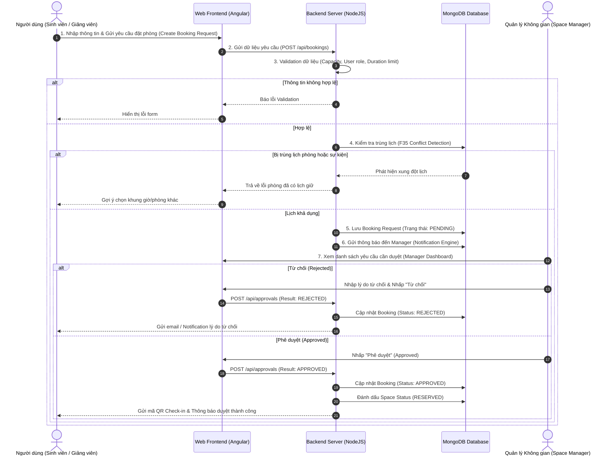
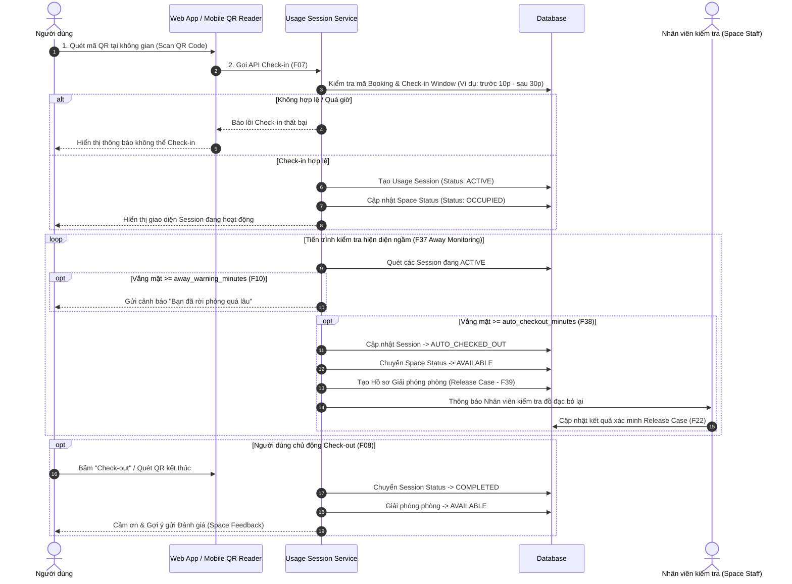
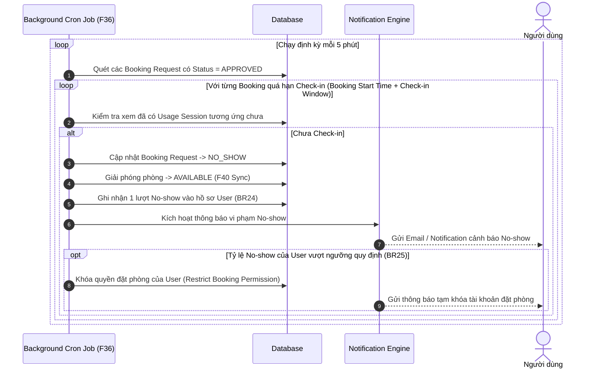
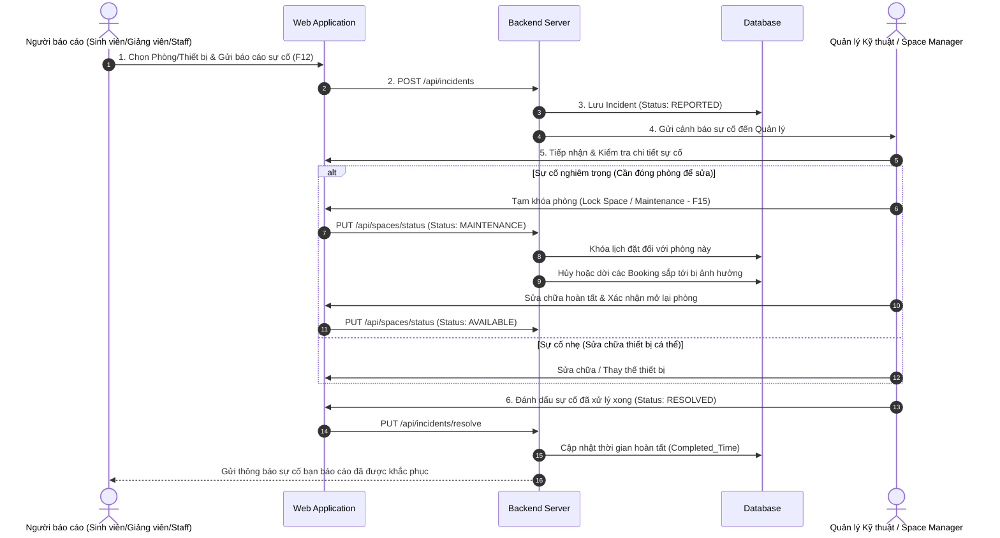

# Quy trình BPMN 2.0 - Campus Space Management System

Tài liệu này định nghĩa các quy trình nghiệp vụ chính của hệ thống theo quy chuẩn **BPMN 2.0 (Business Process Model and Notation)**.

---

## 1. Quy trình Đặt phòng & Phê duyệt (Booking & Approval Process)

> **Bao gồm:** F04 (Create Booking), F19-F20 (Approval Workflow), F35 (Conflict Detection), F14 (Notifications).

---

## 2. Quy trình Check-in, Giám sát Hiện diện & Check-out (Check-in, Presence & Check-out Process)

> **Bao gồm:** F07 (Check-in QR), F08 (Check-out), F09 (Presence Tracking), F10 (Away Warning), F37 (Away Monitoring), F38 (Auto Checkout), F39 (Release Case Creation).

---

## 3. Quy trình Tự động Xử lý No-show (Automated No-show Process)

> **Bao gồm:** F36 (No-show Detection), F40 (Status Synchronization), BR24-BR25 (No-show Policy & Restriction).

---

## 4. Quy trình Báo cáo Sự cố & Bảo trì (Incident Reporting & Maintenance Process)

> **Bao gồm:** F12 (Incident Report), F23 (Incident Processing), F15 (Space Locking).

