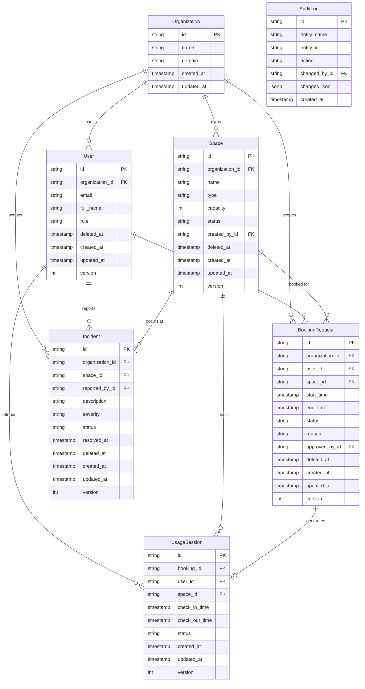

# Campus Space Management ERD

Dựa trên nguyên tắc thiết kế Database Design (`/database-design`), quy chuẩn Normalization (`erd-schema-designer`) và các yêu cầu trong bộ tài liệu đặc tả, đây là sơ đồ Thực thể - Liên kết (ERD) hoàn chỉnh.

### Thiết kế theo nguyên tắc:
1. **Multi-tenancy**: Tất cả các bảng (trừ Organization/Audit) đều có `organization_id` để đảm bảo cô lập dữ liệu (Tenant Isolation) và sẵn sàng cho RLS (Row-Level Security).
2. **Soft Deletion**: Sử dụng `deleted_at` thay vì xóa vật lý.
3. **Auditing**: Bổ sung `created_at`, `updated_at`, `created_by_id`, và bảng `AuditLog` riêng.
4. **Optimistic Locking**: Trường `version` cho các entity quan trọng để tránh conflict khi cập nhật đồng thời (Booking, Space, Incident).
5. **Surrogate Keys**: Sử dụng chuỗi UUID/CUID (`id PK`) cho toàn bộ primary key.

### Sơ đồ ERD (Mermaid)
Để đảm bảo các đường nối gọn gàng và không chồng chéo, các quan hệ được bố trí từ thực thể Root (Organization, User, Space) xuống các thực thể Transaction (Booking, Session, Incident).

### Chiến lược Index
1. **Primary & Foreign Keys**: Tự động đánh index cho các cột FK như `organization_id`, `user_id`, `space_id`, `booking_id`.
2. **Partial Index cho Soft Delete**:
   - `CREATE INDEX idx_space_active ON spaces(organization_id) WHERE deleted_at IS NULL;`
   - `CREATE INDEX idx_booking_active ON booking_requests(space_id, start_time) WHERE deleted_at IS NULL;`
3. **Composite Index**:
   - Bảng BookingRequest: `CREATE INDEX idx_booking_time ON booking_requests (space_id, start_time, end_time, status);` (Để tối ưu F35 - Check Overlap).
   - Bảng UsageSession: `CREATE INDEX idx_session_status ON usage_sessions (status, check_in_time);` (Tối ưu cho Cron Job Auto-checkout).
