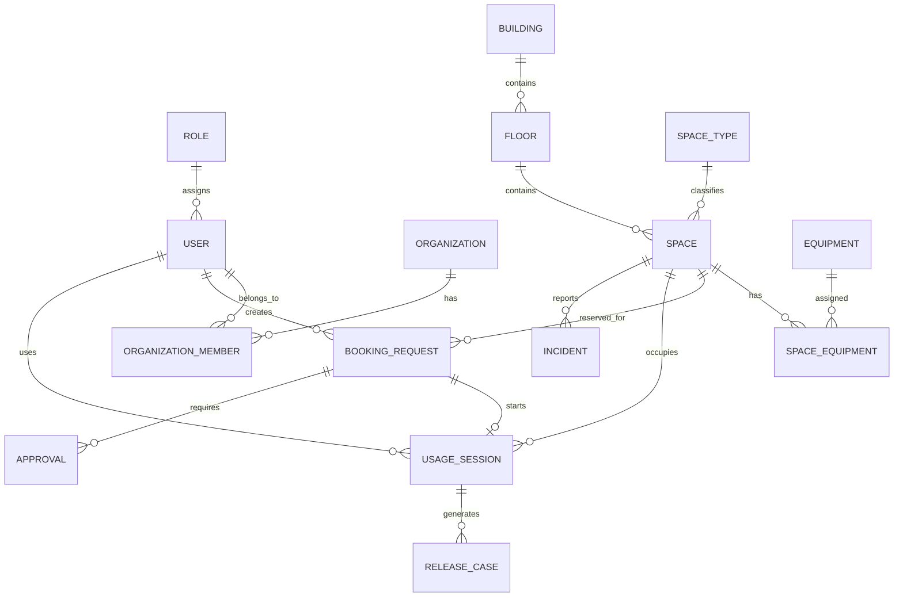
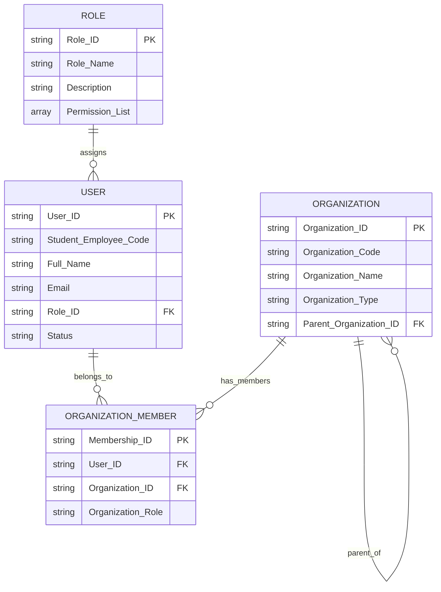
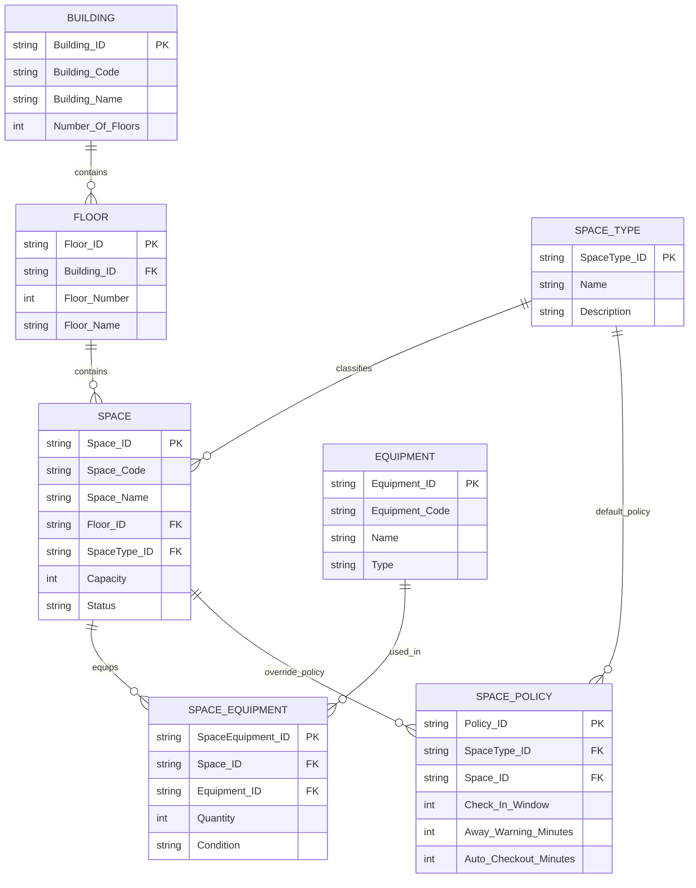
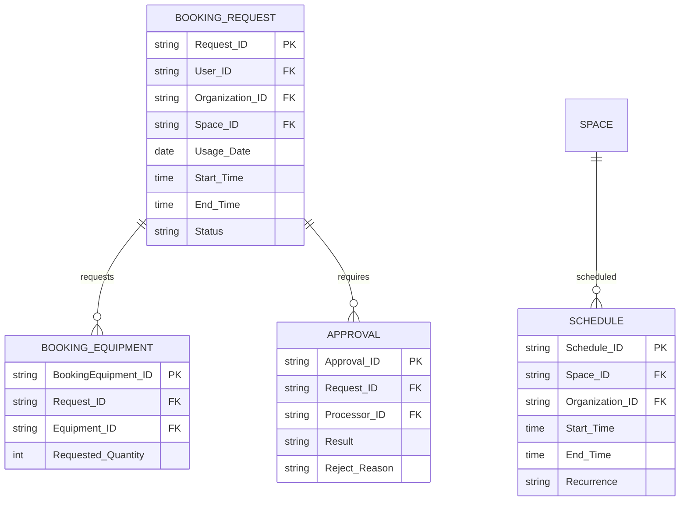
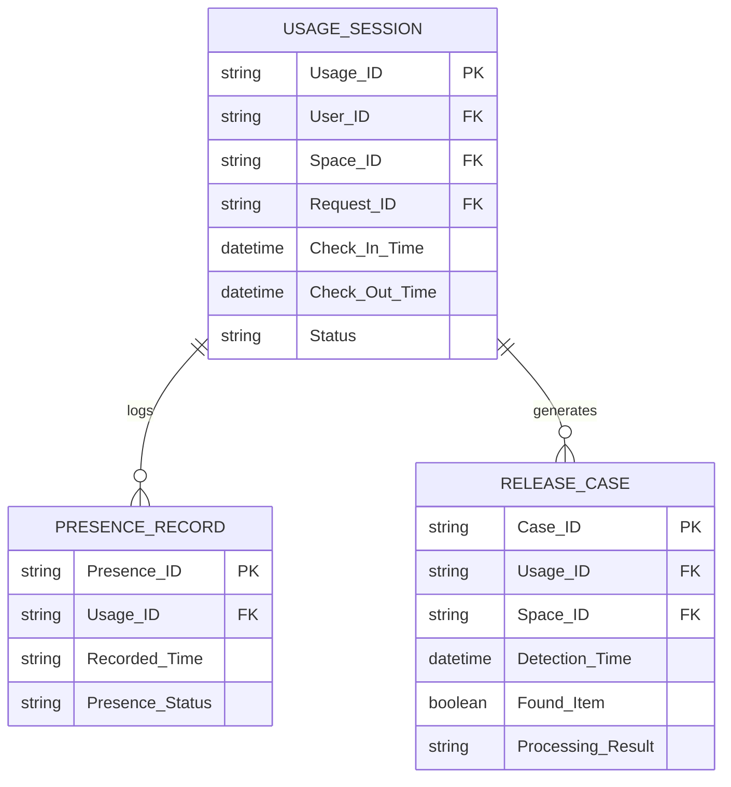
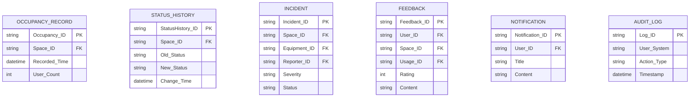

# Sơ đồ Entity Relationship Diagram (ERD) - Campus Space Management System

> **Lưu ý về thiết kế:** Hệ thống gồm 23 thực thể. Để sơ đồ không bị kéo dài lộn xộn và dễ theo dõi nhất, tài liệu này cung cấp **Sơ đồ Tóm tắt Cấp cao (High-Level Core ERD)** cùng **6 Sơ đồ Phân hệ Chi tiết (Modular ERD)**.

---

## 1. Sơ đồ Tổng quan Cấp cao (Core Conceptual ERD)

Sơ đồ thể hiện luồng liên kết chính giữa các thực thể nòng nốt trong hệ thống (đã tinh gọn các bảng chi tiết để các dây nối ngắn và không bị đè lên nhau):

---

## 2. Các Sơ đồ Phân hệ Chi tiết (Modular ERD Diagrams)

### 2.1 Phân hệ Phân quyền & Người dùng (Identity Module)

---

### 2.2 Phân hệ Cơ sở vật chất & Không gian (Space Infrastructure Module)

---

### 2.3 Phân hệ Đặt phòng & Lịch biểu (Booking & Schedule Module)

---

### 2.4 Phân hệ Quản lý Sử dụng & Check-in (Usage Session Module)

---

### 2.5 Phân hệ Giám sát, Sự cố & Đánh giá (Monitoring & Admin Module)

