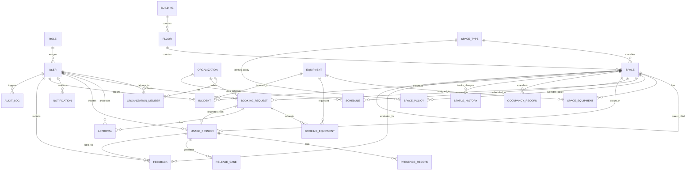
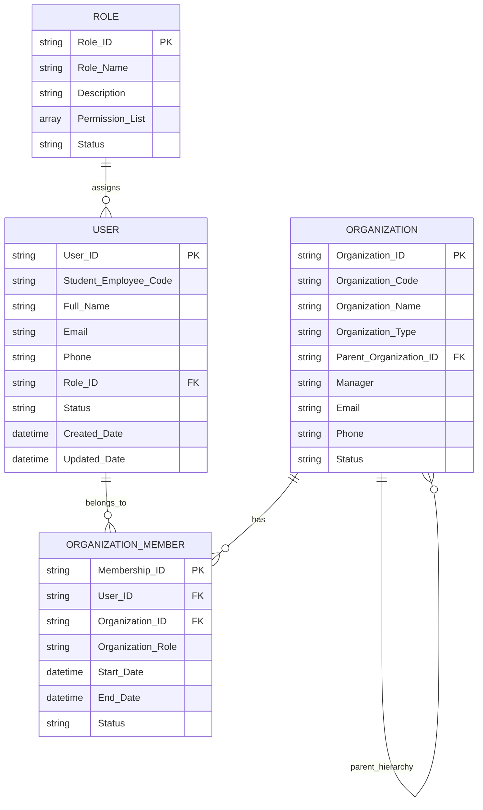
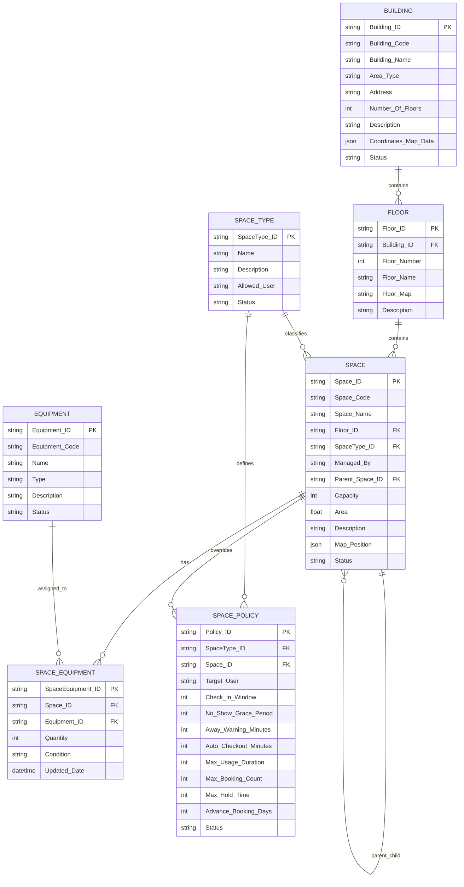
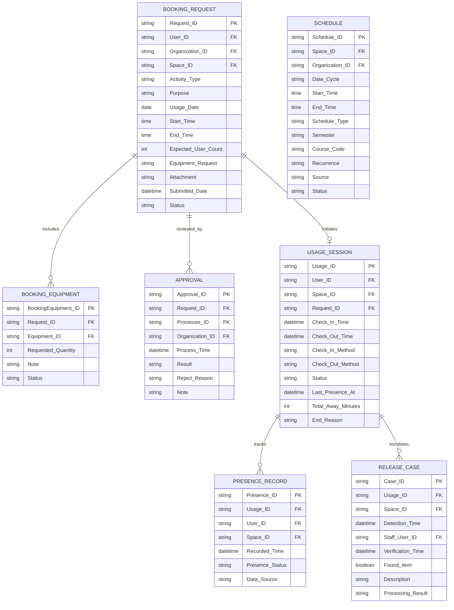
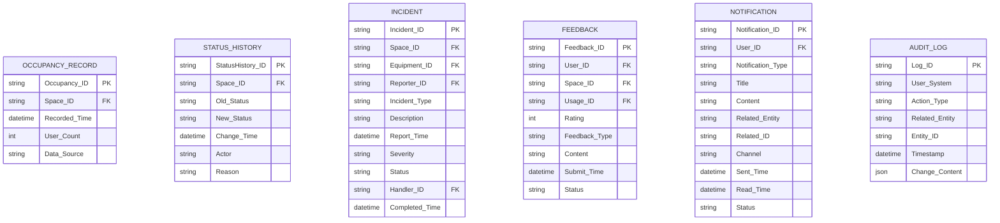

# Sơ đồ Entity Relationship Diagram (ERD) - Campus Space Management System

Tài liệu sơ đồ quan hệ thực thể (ERD) được trích xuất hoàn chỉnh từ [Entity_Specification.md](file:///d:/H%E1%BB%8Dc%20t%E1%BA%ADp/3rd/PTWNC/DoAnCki/Instruction/Entity_Specification.md), bao gồm đầy đủ 23 thực thể (Real-world Entities & System-generated Entities) phân chia theo 7 Phân hệ Database Modules.

---

## 1. Top-Level ERD Overview (Mermaid Syntax)

---

## 2. Detailed Schema Definitions by Module

### 2.1 Identity & Organization Modules

---

### 2.2 Space & Asset Modules

---

### 2.3 Booking & Usage Modules

---

### 2.4 Monitoring & Administration Modules

