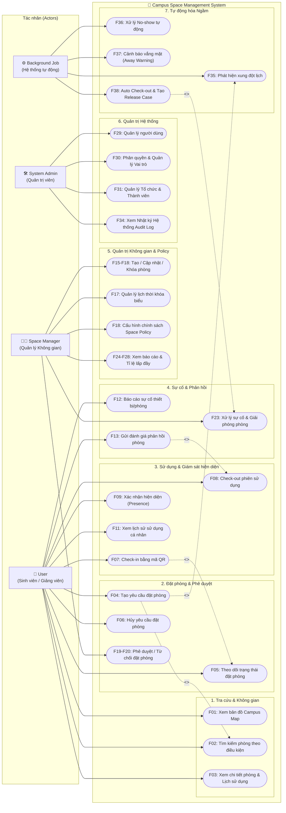

# Sơ đồ Use Case - Campus Space Management System

Tài liệu này định nghĩa đầy đủ danh sách các **Actor**, **Use Case** và **Sơ đồ Use Case (Use Case Diagram)** tuân thủ tiêu chuẩn UML 2.0, trích xuất từ 4 tài liệu spec kỹ thuật [Business_Rules.md](file:///d:/H%E1%BB%8Dc%20t%E1%BA%ADp/3rd/PTWNC/DoAnCki/Instruction/Business_Rules.md), [Function_Instructions.md](file:///d:/H%E1%BB%8Dc%20t%E1%BA%ADp/3rd/PTWNC/DoAnCki/Instruction/Function_Instructions.md), [Entity_Specification.md](file:///d:/H%E1%BB%8Dc%20t%E1%BA%ADp/3rd/PTWNC/DoAnCki/Instruction/Entity_Specification.md) và [Web_Development_OOP_Fullstack_Guide.md](file:///d:/H%E1%BB%8Dc%20t%E1%BA%ADp/3rd/PTWNC/DoAnCki/Instruction/Web_Development_OOP_Fullstack_Guide.md).

---

## 1. Danh sách Actors & Hệ thống

1. **User (Sinh viên / Giảng viên):** Người sử dụng cơ bản, thực hiện tra cứu bản đồ, tìm kiếm phòng, tạo yêu cầu đặt phòng, check-in/check-out, báo cáo sự cố và đánh giá.
2. **Space Manager (Quản lý Không gian - QTTTS / Đơn vị trường):** Quản lý cơ sở vật chất, xét duyệt đặt phòng, thiết lập policy, xử lý sự cố và giải phóng phòng.
3. **System Admin (Quản trị hệ thống):** Quản lý tài khoản, phân quyền, cấu hình hệ thống và xem audit log.
4. **Automated System Jobs (Tiến trình tự động ngầm):** Chạy cron job xử lý xung đột lịch, no-show, cảnh báo vắng mặt, tự động check-out và gửi thông báo.

---

## 2. Sơ đồ Use Case Tổng thể (System Use Case Overview)

---

## 3. Chi tiết Quan hệ Include & Extend theo chuẩn UML 2.0

### 3.1 Quan hệ Phụ thuộc Bắt buộc (`<<include>>`)
1. **`F04: Tạo yêu cầu đặt phòng` INCLUDE `F35: Phát hiện xung đột lịch`**
   - *Mô tả:* Khi người dùng nhấn gửi yêu cầu đặt phòng, hệ thống bắt buộc phải kích hoạt kiểm tra trùng lịch trước khi tạo yêu cầu.
2. **`F07: Check-in bằng mã QR` INCLUDE `F05: Theo dõi trạng thái đặt phòng`**
   - *Mô tả:* Để thực hiện Check-in, hệ thống bắt buộc phải kiểm tra thông tin của mã Đặt phòng đã duyệt sẵn có.
3. **`F38: Auto Check-out` INCLUDE `F22: Tạo hồ sơ giải phóng phòng (Release Case)`**
   - *Mô tả:* Khi hệ thống tự động Check-out do người dùng vắng mặt quá thời hạn, nó luôn tự động sinh ra một `Release Case` để nhân viên quản lý phòng kiểm tra đồ đạc còn sót lại.

---

### 3.2 Quan hệ Mở rộng Điều kiện (`<<extend>>`)
1. **`F13: Gửi đánh giá phản hồi` EXTEND `F08: Check-out phiên sử dụng`**
   - *Điều kiện:* Mở rộng sau khi người dùng vừa hoàn tất Check-out một phiên sử dụng phòng (ACTIVE ➔ COMPLETED).
2. **`F15: Tạm khóa phòng (Maintenance)` EXTEND `F23: Xử lý sự cố (Incident)`**
   - *Điều kiện:* Mở rộng khi Quản lý đánh giá sự cố báo cáo ở mức độ nghiêm trọng cần phong tỏa phòng để bảo trì.
3. **`BR25: Khóa quyền đặt phòng` EXTEND `F36: Xử lý No-show tự động`**
   - *Điều kiện:* Mở rộng khi tổng tỷ lệ `No-show` trong lịch sử người dùng vượt ngưỡng cấu hình của chính sách.
